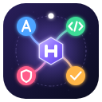
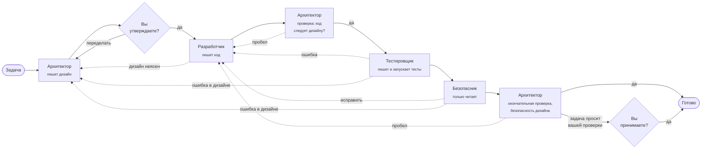

<p align="center">
  <a href="README.md">English</a> · <b>Русский</b>
</p>

<p align="center">
  
</p>

<h1 align="center">AI Harness</h1>

<p align="center">
  <b>Дирижёр для команды ИИ-агентов, которые пишут код.</b><br>
  Он проводит задачу через роли Архитектора, Разработчика, Тестировщика и Безопасника,<br>
  а Архитектор сверяет результат со своим же дизайном.<br>
  Каждую роль играет настоящий консольный агент: Claude Code, Codex CLI, Antigravity CLI, DeepSeek Harness или Cursor CLI<br>
  (с моделями DeepSeek или бесплатными моделями NVIDIA).
</p>

<p align="center">
  <a href="https://github.com/aeygenson/ai-harness/actions/workflows/ci.yml"></a>
  <a href="https://github.com/aeygenson/ai-harness/actions/workflows/security.yml"></a>
  <a href="https://github.com/aeygenson/ai-harness/releases/latest"></a>
  
  
</p>

---

## Зачем он нужен

Один ИИ-агент, который работает над проектом в одиночку, сам проверяет свою же работу: пишет
код, решает, что код хороший, и идёт дальше. Настоящие команды работают лучше, потому что
разные люди проверяют работу друг друга.

AI Harness даёт ИИ-агентам такую же структуру. Вместо одного длинного чата задача проходит
через небольшую команду с понятными обязанностями, письменными передачами работы между
ролями и человеком, который утверждает план. Архитектор, написавший план, сам проверяет, что
код ему действительно следует: перед тестированием и ещё раз в самом конце. В каждую роль
можно поставить своего агента (и свою подписку): например, Claude проектирует, Codex пишет
код, а DeepSeek проверяет, или любое другое сочетание.

У самого Harness **нет своего цикла агента, и он не вызывает API моделей**. Он дирижёр, а не
музыкант: работу делают агенты, а Harness решает, кто работает следующим, запускает каждого
агента с нужными правами, проверяет, что тот сделал, и хранит историю.

## Как идёт задача



Архитектор работает в задаче три раза, и это всегда одна и та же роль:

1. **Дизайн.** Он читает проект и пишет дизайн в `docs/`. Дизайн всегда приходит к вам;
   ничего не строится, пока вы его не утвердите.
2. **Проверка.** Когда Разработчик закончил, Архитектор сравнивает код с утверждённым
   дизайном: все шаги сделаны, интерфейсы такие, как задуманы, ничего лишнего. Пробел
   возвращает работу Разработчику; если оказалось, что ошибся сам дизайн, вопрос приходит к вам.
3. **Окончательная проверка.** После Тестировщика и Безопасника Архитектор ещё раз смотрит
   на весь результат, вместе с их исправлениями и безопасностью дизайна (ввод проверяется там,
   где он входит, секретов нет в коде и логах, прав не больше, чем нужно задаче). Только этот
   шаг может закончить задачу. Если задача или дизайн просят шаг, который можете сделать
   только вы (приёмку, живую проверку, демо), окончательная проверка передаёт результат вам
   с заметками о том, что проверить, и задача готова, когда вы её примете.

Каждое исправление Разработчика снова проходит ту же проверку и все проверки после неё.

Каждая роль заканчивает работу коротким `notes.md` и структурированным `handoff.json`:
вердикт, файлы, которые она меняла, найденные замечания с их важностью и кто, по её мнению,
должен работать дальше. Дальше Harness **доверяет, но проверяет**:

- **Маршруты проверяются.** Роль только предлагает следующий шаг; Harness принимает его,
  только если такой переход есть в разрешённой таблице (например, Тестировщик может вернуть
  работу Разработчику, дизайн Архитектора всегда сначала идёт к вам, а закончить задачу может
  только окончательная проверка Архитектора). Harness помнит, какую из трёх работ сейчас
  делает Архитектор, поэтому дизайн никогда не пропустит ваше утверждение.
- **Границы файлов проверяются.** Архитектор может менять только `docs/`, Тестировщик только
  файлы тестов, Безопасник вообще ничего. Файлы, которые управляют агентами (`.claude/`,
  `AGENTS.md`, `CLAUDE.md`, `.git/` и другие), закрыты для всех ролей, на любой глубине и в
  любом регистре букв.
- **Подмена замечается.** Если агент сам сделает коммит, запуск останавливается. Если он
  изменит `.git/config` (известный способ заставить git позже выполнить команду), Harness
  вернёт старые настройки и остановится. Git hooks проекта никогда не запускаются на коммитах
  Harness.
- **Каждая роль — один git-коммит** с её кодом, её handoff и её заметками, поэтому вся история
  задачи читается в git.
- **Круги ограничены.** После пяти кругов переделок, или как только роль скажет
  `needs_human`, задача останавливается и ждёт вас.

## Возможности

| | |
|---|---|
| **Пять агентов, один интерфейс** | Claude Code, OpenAI Codex CLI, Google Antigravity CLI, DeepSeek Harness (с API DeepSeek или бесплатными моделями NVIDIA) и Cursor CLI за одним трейтом Rust (плюс агент-заглушка для тестов). Агент, модель и уровень усилий выбираются для каждой роли в каждом проекте. |
| **Полноэкранный интерфейс в терминале** | `harness tui` (Ratatui) с вкладками Tasks, Roles, Skills, MCP, Plugins, Retro, Agents и Projects. Работает с мышью и клавиатурой, на английском и русском, в пяти цветовых темах. |
| **Скиллы** | Каждая роль получает встроенные инструкции, которые подходят для любого языка и фреймворка. Проекты хранят свои копии и добавляют свои скиллы, общие для всех агентов. |
| **MCP-серверы и плагины** | Роли можно дать дополнительные инструменты: MCP-серверы (локальные или в интернете, со входом через OAuth) и плагины агентов из каталогов плагинов. |
| **Ретроспектива** | `harness retro` без ИИ считает, что происходило в задачах (круги, отказы, повторяющиеся замечания, неиспользованные скиллы), а потом может попросить агента предложить изменения скиллов, которые вы утверждаете по одному. |
| **Управление из своего ИИ** | `harness mcp-serve` — это MCP-сервер: подключите Claude Code, Codex, Gemini или любого агента, который понимает MCP, спрашивайте, что делают ваши задачи и почему, и давайте ему создавать, запускать и останавливать задачи. Утверждения остаются за вами. |
| **Менеджер агентов** | Установка, обновление, удаление агентов и вход в них на вкладке Agents. `harness doctor` проверяет, что Git, Node.js и хотя бы один агент готовы. |
| **Изолированные агенты** | Каждый проект сам настраивает своих агентов: ваши личные плагины, MCP-серверы и сохранённые ключи в него не попадают. |
| **Аккуратное обращение с секретами** | Входы и ключи хранятся в `~/.harness/credentials/` (читать можете только вы), никогда не попадают в проект, git, логи или окружение агента и показываются как `***` в каждом логе. |
| **Работает везде** | Linux, macOS (Apple silicon и Intel) и Windows, с установщиками в одну команду и готовыми программами. |

## Быстрый старт

**macOS или Linux**

```bash
curl -fsSL https://raw.githubusercontent.com/aeygenson/ai-harness/main/install/install.sh | bash
```

**Windows (PowerShell)**

```powershell
irm https://raw.githubusercontent.com/aeygenson/ai-harness/main/install/install.ps1 | iex
```

Установщик добавляет то, чего не хватает (Git, Node.js, редактор Zed), и не трогает то, что
уже есть, поэтому второй запуск занимает секунды; программа `harness` всегда самой новой
версии. Ещё он добавляет **AI Harness** в ваши приложения. Дальше Harness обновляет себя сам:
интерфейс показывает свою версию и предлагает новый выпуск в верхней строке («Update Harness»
на вкладке Agents), а `harness update` делает то же из командной строки. Агенты
устанавливаются и входят в ваши аккаунты на вкладке **Agents**, с подписками, которые у вас
уже есть.

Чтобы удалить Harness, запустите `install/uninstall.sh` (macOS, Linux) или
`install/uninstall.ps1` (Windows) так же, как установщик. Ваши проекты и `~/.harness` (входы,
настройки) остаются, так что повторная установка всё найдёт; добавьте `--purge` (в Windows
сначала `$env:HARNESS_PURGE = "1"`), чтобы удалить и `~/.harness`.

Потом откройте интерфейс:

```bash
harness tui
```

Всё можно сделать в интерфейсе. Те же шаги из командной строки:

```bash
cd ~/code/my-project                 # любой git-репозиторий
harness init                         # создать .harness/harness.toml
harness github vgs-prototype         # выложить проект на GitHub (закрытый репозиторий)
harness task new task-001 "Add a CSV export to the report page"
harness run task-001                 # Архитектор пишет дизайн и ждёт вас
harness approve task-001             # дальше Разработчик, Тестировщик и Безопасник,
                                     # а Архитектор дважды проверяет код
harness stop task-001                # остановить запуск в интерфейсе или другом терминале (--now: сразу)
harness status task-001              # где задача и её история
harness retro task-001               # что получилось и что улучшить
```

Чтобы собрать из исходников, нужен Rust: `cargo build --release -p harness-cli`, или
запустите установщик с `bash -s -- --dev`. Harness, собранный из исходников, обновляет себя из
своей папки git: «Update Harness» (или `harness update`) выполняет `git pull --ff-only` и
собирает его заново, когда в ветке на GitHub появились новые коммиты.

## Устройство

Рабочее пространство Rust из шести крейтов. Движок синхронный и без интерфейса, поэтому его
легко тестировать, и ему всё равно, кто им управляет (CLI или TUI) и какой агент работает.

```
 harness-cli ──┐                 ┌── harness-tui
 (clap)        │                 │   (ratatui)
               ▼                 ▼
            ┌─────────────────────────┐
            │       harness-core      │  задачи, маршруты, handoff, проверки,
            │                         │  настройки, скиллы, MCP, ретро, git
            └────────────┬────────────┘
                         ▼
            ┌─────────────────────────┐
            │     harness-agents      │  адаптеры: Claude Code, Codex,
            │      (tokio)            │  Antigravity, DeepSeek, заглушка
            └────────────┬────────────┘
                         ▼
            ┌─────────────────────────┐
            │    harness-platform     │  всё, что отличается между
            │                         │  Linux, macOS и Windows
            └─────────────────────────┘
```

`harness-fake` — маленькая программа только для тестов. Она одинаково на всех трёх системах
изображает агента, `curl` или MCP-сервер.

Подробнее: [дизайн](docs/design.md) и [формат handoff](docs/handoff-format.md).

## Сделано с ИИ, и это нарочно

Этот проект ещё и эксперимент: **как строить настоящие программы вместе с ИИ-агентами**, и
запись того, как это выглядит, когда делать это аккуратно.

- **Сначала дизайн, потом код.** Каждая часть начиналась с письменного дизайна, который
  обсуждали и утверждали до того, как написать код ([docs/design.md](docs/design.md) хранит
  решения).
- **ИИ пишет, человек решает.** Код писал Claude Code небольшими pull request'ами, их около
  120. Каждый просмотрел и слил человек, и каждый должен был пройти CI на Linux, macOS и
  Windows.
- **Правила для агентов лежат в репозитории.** [AGENTS.md](AGENTS.md) говорит каждому
  агенту, как здесь работать: код, понятный тому, кто учит Rust, никаких `unwrap()` в рабочем
  коде, никаких секретов нигде, тест на каждое поведение, файлы не длиннее примерно 300
  строк. Ещё он принимает [Pragmatic Rust Guidelines](docs/rust-guidelines.md) от Microsoft.
- **Правила проверяет машина.** Clippy работает с группой `pedantic` и выбранными lint'ами
  `restriction` как с ошибками, `missing_docs` ломает сборку, а `cargo deny` каждый день
  проверяет все зависимости на известные уязвимости.
- **Тесты без сети.** Около 380 тестов используют агента-заглушку, поддельную программу и
  временные git-репозитории, поэтому они одинаково идут на любой системе.
- **Используется по-настоящему.** Harness уже управлял своими агентами, чтобы построить другие
  проекты, например программу эскроу на Solana, которую целиком написали роли.

Harness применяет ту же идею к каждому проекту, который ведёт: работу делает ИИ, структура и
проверки держат его честным, а важные решения остаются за человеком.

## Состояние

Версия 0.10.0. Основной путь задачи, пять агентов (Cursor CLI новый, живьём ещё не проверен), интерфейс, MCP, плагины, ретроспективы и
установщики работают, ими пользуются на Linux. macOS и Windows проходят CI; живая проверка
на этих системах идёт.
